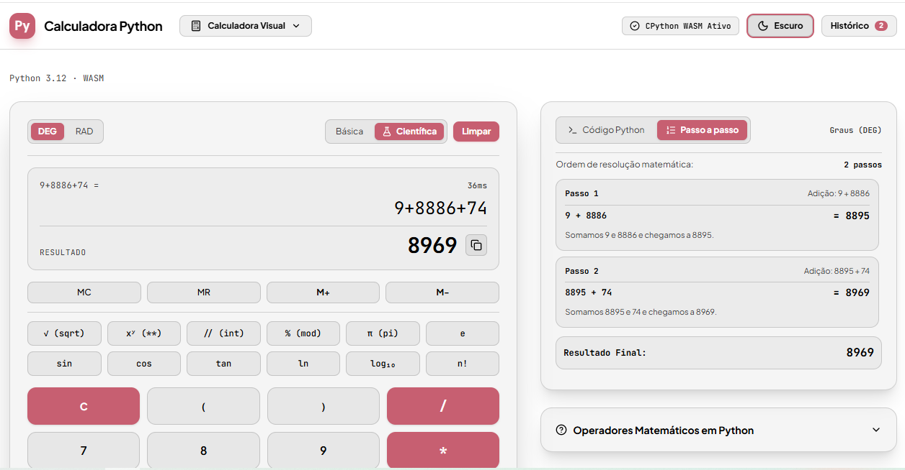
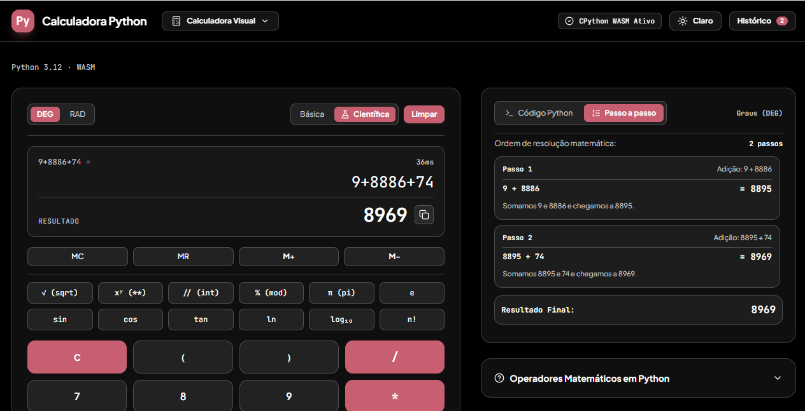
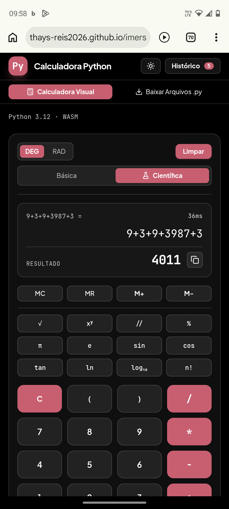

# 🧮 Calculadora Científica com IA | AI-Powered Scientific Calculator

🇧🇷 **Português** | 🇺🇸 **English**

🔗 **[Acesse o projeto: Calculadora Científica com IA](https://thays-reis2026.github.io/imersao-engenharia-software-ia/)**

---

## 🇧🇷 Sobre o Projeto

Este projeto foi desenvolvido durante a **Imersão Engenharia de Software: Dev na Era da IA, da Alura**, com o objetivo de explorar o desenvolvimento de software com o auxílio da inteligência artificial.

A aplicação é uma calculadora científica criada com suporte do **Google AI Studio**, que executa **Python de verdade no navegador** e permite realizar cálculos e consultar explicações passo a passo sobre como os resultados são obtidos.

Além da implementação proposta durante a imersão, personalizei as cores, a interface da aplicação e implementei uma funcionalidade de explicação dos cálculos, tornando a experiência mais interativa e educativa.

### ✨ Funcionalidades

- 🧮 **Cálculos matemáticos:** modos Básica e Científica, alternância entre graus e radianos (DEG/RAD), teclas de memória (MC, MR, M+, M-) e histórico de cálculos, que pode ser exportado em `.txt`.
- 📚 **Explicação passo a passo:** cada cálculo é explicado em português simples, na ordem das operações (parênteses, funções, potências, multiplicação e divisão, soma e subtração), com mensagens amigáveis para entradas inválidas, como divisão por zero.
- 🐍 **Código Python equivalente:** a aplicação mostra o código Python correspondente a cada cálculo, pronto para copiar.
- 🎨 **Interface personalizada:** paleta de cores e elementos visuais adaptados por mim, com **modo claro e escuro**.
- 📱 **Design responsivo:** duas colunas no computador e coluna única no tablet e no celular. Em aparelhos de toque, o teclado do celular não sobe, e a calculadora é usada pelos próprios botões da tela.
- 💻 **Extras no computador:** terminal Python interativo (REPL), editor de scripts e calculadoras `.py` prontas para baixar (terminal, interface gráfica com Tkinter, orientada a objetos e científica).

### 🛠️ Tecnologias e Ferramentas

- **Google AI Studio:** apoio à criação e ao desenvolvimento da aplicação com inteligência artificial.
- **React 19, TypeScript e Vite:** estrutura da aplicação.
- **Tailwind CSS 4:** estilização e design responsivo.
- **Pyodide (Python em WebAssembly):** execução de Python no navegador.
- **GitHub Actions e GitHub Pages:** publicação automática a cada atualização.

### 💡 Aprendizados

Durante a imersão, explorei o desenvolvimento de aplicações com apoio de inteligência artificial e a importância de personalizar soluções para atender melhor às necessidades dos usuários.

O projeto também foi uma oportunidade de experimentar melhorias na interface e implementar uma funcionalidade voltada à compreensão dos cálculos, aproximando a calculadora de uma ferramenta de aprendizagem. Testei a aplicação no celular e ajustei detalhes de uso, como o comportamento do teclado, e aprendi a publicar o projeto online e a acompanhar os resultados de cada publicação no GitHub Actions.

### ▶️ Como executar localmente

Requer o [Node.js](https://nodejs.org/).

```bash
cd calculadora-python
npm install
npm run dev
```

Depois, abra http://localhost:3000. Não é necessária chave de API.

### 🚀 Acesse o Projeto

🔗 **[Calculadora Científica — Acessar aplicação](https://thays-reis2026.github.io/imersao-engenharia-software-ia/)**

🔗 **[Repositório no GitHub](https://github.com/thays-reis2026/imersao-engenharia-software-ia)**

---

## 🇺🇸 About the Project

This project was developed during **Alura's Software Engineering Immersion: Dev in the AI Era**, exploring software development with the assistance of artificial intelligence.

The application is a scientific calculator created with support from **Google AI Studio**. It runs **real Python in the browser**, allowing users to perform calculations and explore step-by-step explanations of how results are obtained.

In addition to implementing the initial proposal, I customized the application's colors and interface and added a feature that explains calculations step by step, making the experience more interactive and educational.

### ✨ Features

- 🧮 **Mathematical calculations:** Basic and Scientific modes, degrees/radians switch (DEG/RAD), memory keys (MC, MR, M+, M-) and a calculation history that can be exported as `.txt`.
- 📚 **Step-by-step explanations:** every calculation is explained in plain language, following the order of operations (parentheses, functions, powers, multiplication/division, addition/subtraction), with friendly messages for invalid input such as division by zero.
- 🐍 **Equivalent Python code:** the app shows the Python code that matches each calculation, ready to copy.
- 🎨 **Customized interface:** color palette and visual elements personalized by me, with **light and dark mode**.
- 📱 **Responsive design:** two columns on desktop and a single column on tablet and mobile. On touch devices the on-screen keyboard does not pop up, and the calculator is used through its own buttons.
- 💻 **Desktop extras:** interactive Python terminal (REPL), script editor and ready-to-download `.py` calculators (terminal, Tkinter GUI, object-oriented and scientific versions).

### 🛠️ Technologies and Tools

- **Google AI Studio:** AI-assisted application development.
- **React 19, TypeScript and Vite:** application structure.
- **Tailwind CSS 4:** styling and responsive design.
- **Pyodide (Python in WebAssembly):** running Python in the browser.
- **GitHub Actions and GitHub Pages:** automatic deployment on every update.

### 💡 What I Learned

During the immersion, I explored AI-assisted application development and the importance of adapting solutions to better meet users' needs.

This project also gave me the opportunity to experiment with interface customization and implement a feature focused on helping users understand calculations, turning the calculator into a more educational tool. I tested the app on a phone and adjusted usage details such as the keyboard behavior, and I learned to publish the project online and follow each deployment in GitHub Actions.

### ▶️ Run locally

Requires [Node.js](https://nodejs.org/).

```bash
cd calculadora-python
npm install
npm run dev
```

Then open http://localhost:3000. No API key is required.

### 🚀 Project Links

🔗 **[Scientific Calculator — Open Application](https://thays-reis2026.github.io/imersao-engenharia-software-ia/)**

🔗 **[GitHub Repository](https://github.com/thays-reis2026/imersao-engenharia-software-ia)**

---

## 📸 Prints | Screenshots

| Modo claro / Light mode | Modo escuro / Dark mode | Celular / Mobile |
| :---: | :---: | :---: |
|  |  |  |
